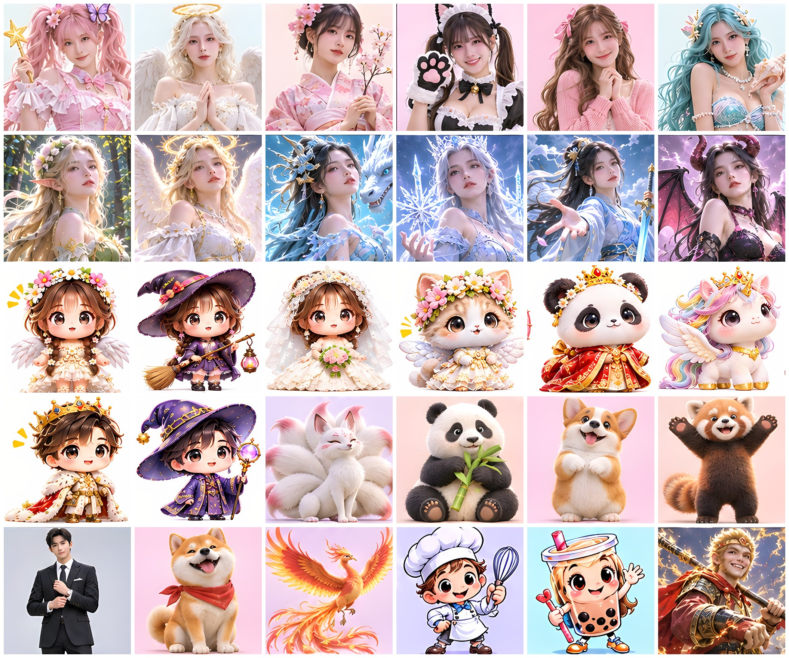
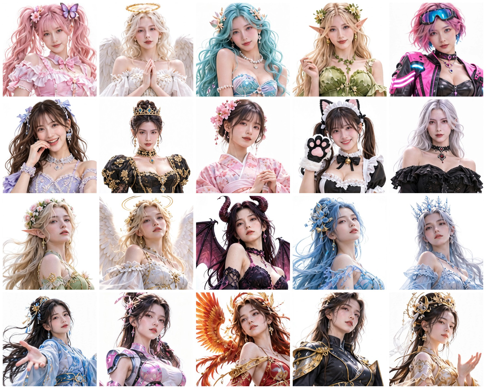
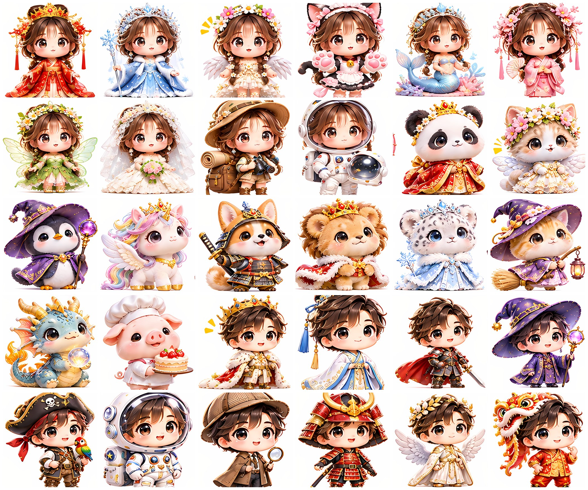
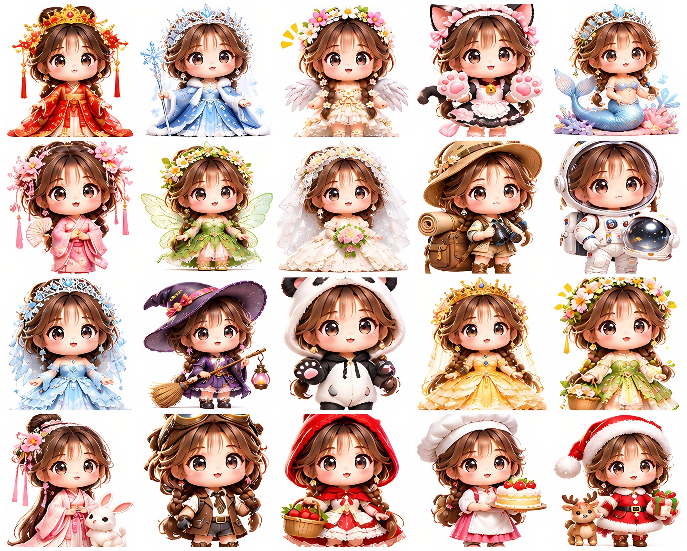
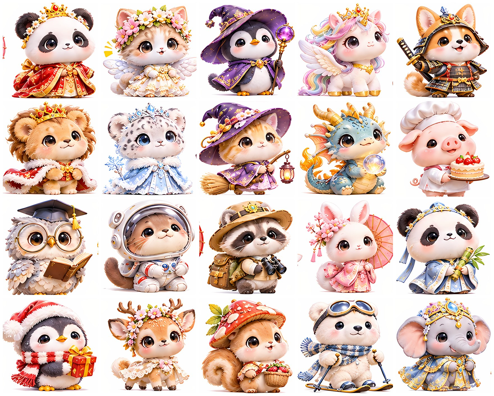
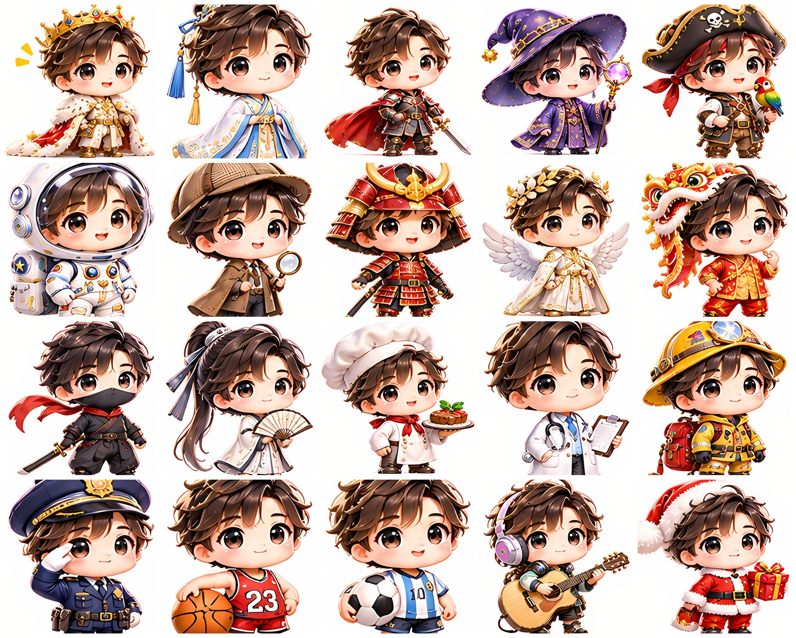
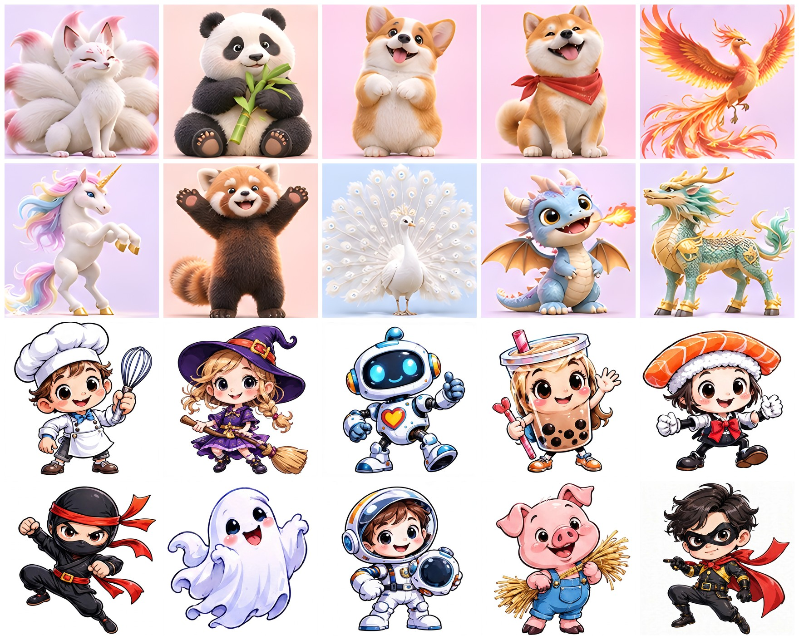
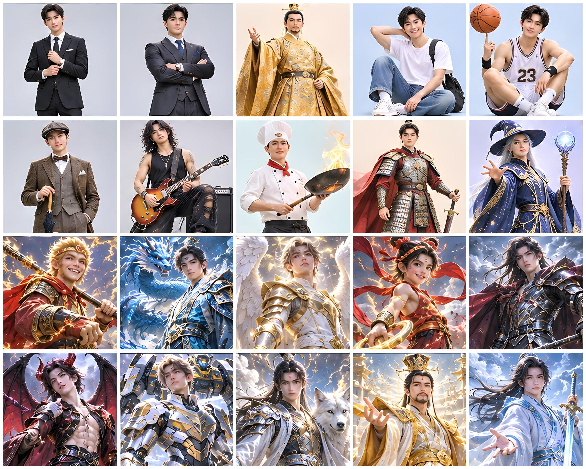
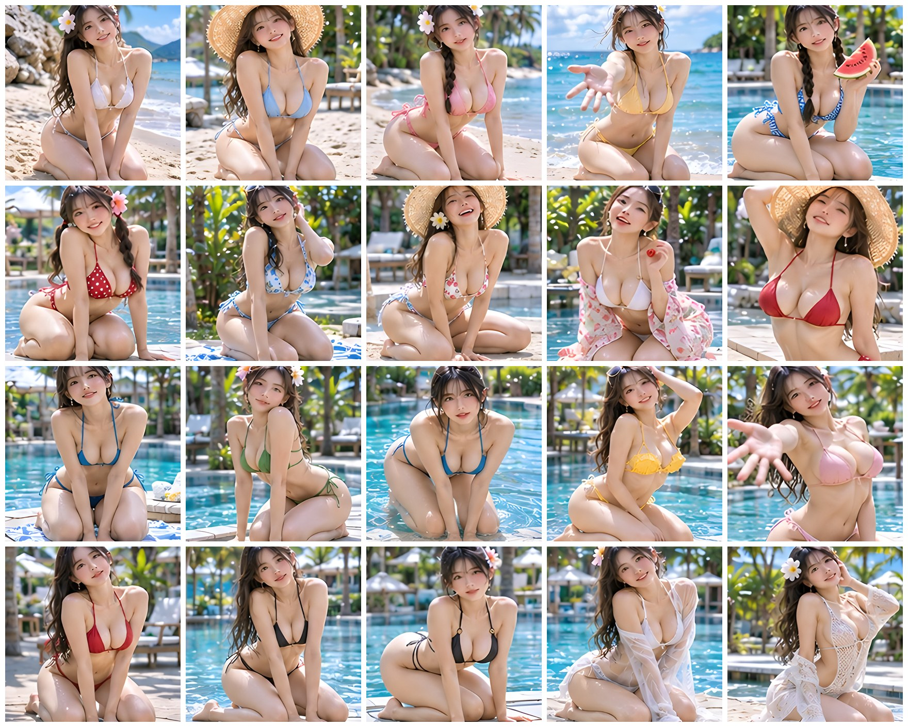

# Muse 形象合集

> 一张图 + 一句话，给你的 Muse 换上新形象。
>
> **353 个形象** —— 挑中意的下载下来，配一句话提示词，发给你的 Muse 就能换上。

## 先看图

精选总览（30 个）：



女性版 + 幻想女版精选：



Q版精选总览（30 个）：



Q版换装版精选：



Q版萌宠版精选：



Q版男孩版精选：



动物版 + 卡通版精选：



男性版 + 幻想男版精选：



夏日清凉版精选：




## 目录

- [快速开始](#快速开始)
- [角色总览](#角色总览)
- [基本概念：状态动画](#基本概念状态动画)
- [使用须知](#使用须知)
- [仓库结构](#仓库结构)
- [投稿](#投稿)
- [许可](#许可)

## 快速开始

挑一个形象下载，把图发给你的 Muse，再粘贴一句话提示词，就这么简单。

1. **给图** —— 在聊天里把图片当附件发给你的 Muse：自己的照片，或者直接用合集里的静态图。
2. **说一句话** —— 复制案例的“一键话术”粘贴发送：

> 以这个形象作为你的静态，并重画6个状态动画（待机、工作、做东西、连接中、升级庆祝、等帮手）

3. **选候选** —— Muse 会做出 2–4 个候选，你回一句“选第 X 个”，形象即换好。声音在通话里另行试听更换。

完整教程（7 步详解、声音速查、实战例子）见 [cases.md](cases.md)。

## 形象总览

| 分组 | 代码 | 数量 | 分类 |
| --- | --- | ---: | --- |
| 女性版 | `female` | 36 | 甜美系 · 气质系 · 魅力系 · 幻想系 · 风格系 · 角色系 |
| Q版换装版 | `chibi` | 36 | 公主系 · 古风系 · 梦幻系 · 童话系 · 冒险系 · 日常系 |
| Q版萌宠版 | `chibi-pets` | 36 | 梦幻系 · 宫廷系 · 田园系 · 职业系 · 冒险系 · 日常系 |
| Q版男孩版 | `chibi-boys` | 36 | 宫廷系 · 古风系 · 冒险系 · 职业系 · 运动系 · 才艺系 |
| 动物版 | `animals` | 36 | 萌宠系 · 优雅系 · 威猛系 · 海空系 · 灵兽系 · 野趣系 |
| 男性版 | `male` | 36 | 少年系 · 绅士系 · 型男系 · 古风系 · 职业系 · 幻想系 |
| 幻想女版 | `fantasy-female` | 36 | 仙侠系 · 神话系 · 西方幻想系 · 魔法系 · 奇幻兽伴系 · 未来幻想系 |
| 幻想男版 | `fantasy-male` | 34 | 仙侠系 · 神话系 · 西方幻想系 · 魔法系 · 奇幻兽伴系 · 未来幻想系 |
| 卡通版 | `cartoon` | 31 | 经典卡通系 · 童话卡通系 · 英雄卡通系 · 美食卡通系 · 职业卡通系 · 怪物伙伴系 |
| 夏日清凉版 | `summer` | 36 | 海滩系 · 泳池系 · 度假系 · 甜美系 · 轻熟系 · 活力系 |
| **合计** | | **353** | |

每个案例的详情（人设 / 形象设计 / 声音匹配 / 动态效果 / 一键话术）见 [cases.md](cases.md)；图片文件名索引见 [examples/README.md](examples/README.md)，图片本体在「Muse 形象合集」空间中展示。

## 基本概念：状态动画

每个形象配 **6 个状态动画**：待机、工作、做东西、连接中、升级庆祝、等帮手。

- 状态动画由 Muse 在设置形象时按静态图现场重画，**不需要预先制作**，一句话提示词里已经包含这一步。
- 就按这 6 个状态来，不要自己往上加。
- 换形象后，状态动画要按新形象重画，旧的不通用。

## 使用须知

- **照片要合规**：脸清楚、光线好、穿日常衣服。裸露、私密照片会被系统拒绝，候选全部作废。
- **比例不用管**：Muse 会自动把图片调整为头像比例；想要效果稳妥，静态图以 1:1、脸部居中、五官无遮挡为准。
- **背景固定为白色**，目前不支持其他背景。
- **动态是排队生成的**，做好后逐个发送到聊天里，需要等一会儿。
- **声音必须试听**：在通话里听效果再定，只看文字描述不准。

## 仓库结构

```text
.
├── README.md # 本文件：门面与总览
├── cases.md # 全部 353 个案例 + 完整教程
├── CONTRIBUTING.md # 投稿指南与模板
└── examples/
├── README.md # 静态图文件名索引
├── female/ # 女性版静态图
├── chibi/ # Q版换装版静态图
├── chibi-pets/ # Q版萌宠版静态图
├── chibi-boys/ # Q版男孩版静态图
├── animals/ # 动物版静态图
├── male/ # 男性版静态图
├── fantasy-female/ # 幻想女版静态图
├── fantasy-male/ # 幻想男版静态图
├── cartoon/ # 卡通版静态图
└── summer/ # 夏日清凉版静态图
```

## 投稿

欢迎投稿新案例，格式与审核口径见 [CONTRIBUTING.md](CONTRIBUTING.md)。要点：五项内容齐全、一键话术可直接复制使用、图片只收本人照片或 AI 生成图。

## 许可

案例文字内容欢迎转载，注明出处即可。图片素材仅限本人照片或 AI 生成图，禁止上传他人照片与任何私密照片。
